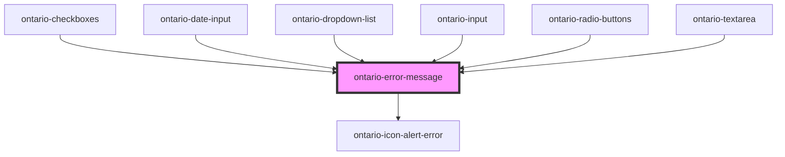

import { OntarioErrorMessage } from '@ongov/ontario-design-system-component-library-react';
import Tabs from '@theme/Tabs';
import TabItem from '@theme/TabItem';

# ontario-error-message

## Usage guidance

Use `ontario-error-message` to render plain-text error content for a native field that is not already displaying an error through an ODS form control. The component encapsulates its presentation in Shadow DOM. Keep its host in the same document tree as the field and reference the host's native `id` from `aria-describedby`. The existing `element-id` property remains an alias that sets the host ID; if both are supplied, `element-id` takes precedence. Set the field's `aria-invalid` to `true` while the error applies, and preserve any existing hint IDs in `aria-describedby`.

ODS form controls use this same component inside their own shadow roots and manage error associations, invalid state and summary integration for you. Set the control's error property rather than adding a second error component.

The legacy `ErrorMessage` functional renderer at `src/utils/components/error-message/error-message.tsx` is deprecated, not removed. Its companion SCSS remains available for existing hybrid integrations. Existing `error`/`message` usage retains its rendering and hidden-state behaviour. New integrations should use `ontario-error-message`; when migrating, replace the legacy `error` flag with an empty `message` when no error applies, reference the component's host ID, and use `announce` to coordinate live announcements. This compatibility retention does not add a new package export or change package subpath resolution.

The component announces new content by default using an alert. Set `announce="false"` when the same update is already announced by another live region, such as an error summary, to avoid duplicate announcements. Do not disable an inline announcement merely because an `ontario-error-alert` is active: that alert does not collect or announce errors from native fields.

Missing, empty and whitespace-only messages hide the component. A whitespace-only message also produces an ODS console warning on initialisation or when `message` changes; use an empty string to clear an error intentionally. Leading and trailing whitespace in otherwise meaningful messages is preserved.

## Configuration and validation

The application is responsible for validating native fields, updating `message`, setting or removing `aria-invalid`, and updating `aria-describedby` when errors appear or clear. Keep hint IDs in `aria-describedby` in both states. Place the message after any hint and before the field, and use clear text explaining how to correct the error.

For example, after a failed validation, set `message` to the error text, set `aria-invalid="true"` and include the message host ID alongside any hint IDs. When the error is corrected, set `message` to an empty string, remove `aria-invalid` and remove the error ID from `aria-describedby` while retaining the hint IDs. The component does not validate the field or perform these updates for the application.

`ontario-error-alert` does not collect standalone error messages or native-field errors. See [native fields and mixed forms](../ontario-error-alert/#native-fields-and-mixed-forms) for the summary's limitation and the integrated example.

For a server response that must work without JavaScript, render the error text and native-field associations in HTML. See the [server-rendered error example](../ontario-error-alert/#server-rendered-errors); a client-side component cannot announce an error before JavaScript runs.

## Examples

These examples show the invalid state. Applications must update the message and field attributes as validation changes.

```mdx-code-block
<Tabs
	defaultValue="html"
	values={[
		{label: 'HTML', value: 'html'},
		{label: 'React', value: 'react'},
		{label: 'Angular', value: 'angular'},
	]}
	groupId="framework"
	queryString="framework">
<TabItem value="html">
```

```html
<label for="email">Email</label>
<input id="email" aria-invalid="true" aria-describedby="email-hint email-error" />
<span id="email-hint">Use the address associated with your account.</span>
<ontario-error-message id="email-error" message="Enter a valid email address."></ontario-error-message>
```

```mdx-code-block
</TabItem>
<TabItem value="react">
```

```tsx
<>
	<label htmlFor="email">Email</label>
	<input id="email" aria-invalid="true" aria-describedby="email-hint email-error" />
	<span id="email-hint">Use the address associated with your account.</span>
	<OntarioErrorMessage id="email-error" message="Enter a valid email address." />
</>
```

```mdx-code-block
</TabItem>
<TabItem value="angular">
```

```html
<label for="email">Email</label>
<input id="email" [attr.aria-invalid]="true" aria-describedby="email-hint email-error" />
<span id="email-hint">Use the address associated with your account.</span>
<ontario-error-message id="email-error" message="Enter a valid email address."></ontario-error-message>
```

```mdx-code-block
</TabItem>
</Tabs>
```

<div>
	<label htmlFor="error-message-example-email">Email</label>
	<span id="error-message-example-hint">Use the address associated with your account.</span>
	<OntarioErrorMessage id="error-message-example-error" message="Enter a valid email address." announce={false} />
	<input id="error-message-example-email" aria-invalid="true" aria-describedby="error-message-example-hint error-message-example-error" />
</div>

The rendered example is a static invalid state. Its announcement is disabled because it is not an error update resulting from a user's action.

For a group, keep the native `fieldset` and `legend` and associate the error with each affected native option. Put the message in the same DOM tree as those native controls. Set the language on the message when its text differs from the surrounding page language.

```html
<fieldset aria-describedby="contact-method-error">
	<legend>Preferred contact method</legend>
	<label
		><input type="checkbox" name="contact" value="email" aria-invalid="true" aria-describedby="contact-method-error" />
		Email</label
	>
	<label
		><input type="checkbox" name="contact" value="phone" aria-invalid="true" aria-describedby="contact-method-error" />
		Phone</label
	>
	<ontario-error-message
		lang="fr"
		id="contact-method-error"
		message="Choisissez une méthode de contact."
	></ontario-error-message>
</fieldset>
```

## Accessibility verification

In addition to automated checks, manually test with the browsers and assistive technologies supported by the application:

- Focus an invalid field and confirm that its label, hint and error are available and that its invalid state is conveyed.
- Trigger a new error and confirm it is announced once. When another live region announces the same error, verify the application's `announce` setting avoids duplication without silencing errors that region does not report.
- Correct the error and confirm the message is hidden, the invalid state and error description are removed, and the hint remains associated.
- For grouped native controls, check the legend and error association for each affected option. Also check keyboard navigation and visible focus.

<!-- Auto Generated Below -->

## Overview

Displays a plain-text error message for a form control.

Add this component's host ID to the associated native field's
`aria-describedby` value and set `aria-invalid` while the field is invalid.

## Properties

| Property    | Attribute    | Description                                                                                                   | Type                  | Default     |
| ----------- | ------------ | ------------------------------------------------------------------------------------------------------------- | --------------------- | ----------- |
| `announce`  | `announce`   | Whether the error should be announced when it is rendered.                                                    | `boolean`             | `true`      |
| `elementId` | `element-id` | An alias for the host ID used by the associated field's `aria-describedby`. Prefer the native `id` attribute. | `string \| undefined` | `undefined` |
| `message`   | `message`    | The plain-text error message. An empty message is not rendered.                                               | `string \| undefined` | `undefined` |

## Dependencies

### Used by

- [ontario-checkboxes](../ontario-checkboxes)
- [ontario-date-input](../ontario-date-input)
- [ontario-dropdown-list](../ontario-dropdown-list)
- [ontario-input](../ontario-input)
- [ontario-radio-buttons](../ontario-radio-buttons)
- [ontario-textarea](../ontario-textarea)

### Depends on

- [ontario-icon-alert-error](../ontario-icon)

### Graph



---

_Built with [StencilJS](https://stenciljs.com/)_
