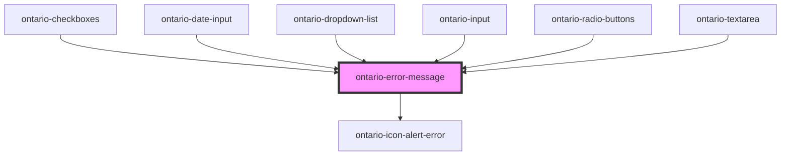

import { OntarioErrorMessage } from '@ongov/ontario-design-system-component-library-react';
import Tabs from '@theme/Tabs';
import TabItem from '@theme/TabItem';

# ontario-error-message

Use `ontario-error-message` to render plain-text error content for a native field that is not already displaying an error through an ODS form control. The component encapsulates its presentation in Shadow DOM. Keep its host in the same document tree as the field and reference the host's native `id` from `aria-describedby`. The existing `element-id` property remains an alias that sets the host ID; if both are supplied, `element-id` takes precedence. Set the field's `aria-invalid` to `true` while the error applies, and preserve any existing hint IDs in `aria-describedby`.

ODS form controls use this same component inside their own shadow roots and manage error associations, invalid state and summary integration for you. Set the control's error property rather than adding a second error component.

The legacy `ErrorMessage` functional renderer at `src/utils/components/error-message/error-message.tsx` is deprecated, not removed. Its companion SCSS remains available for existing hybrid integrations. Existing `error`/`message` usage retains its rendering and hidden-state behaviour. New integrations should use `ontario-error-message`; when migrating, replace the legacy `error` flag with an empty `message` when no error applies, reference the component's host ID, and use `announce` to coordinate live announcements. This compatibility retention does not add a new package export or change package subpath resolution.

The component announces new content by default using an alert. Set `announce="false"` when the same update is already announced by another live region, such as an error summary, to avoid duplicate announcements.

Missing, empty and whitespace-only messages hide the component. A whitespace-only message also produces an ODS console warning on initialisation or when `message` changes; use an empty string to clear an error intentionally. Leading and trailing whitespace in otherwise meaningful messages is preserved.

```mdx-code-block
<Tabs
	defaultValue="html"
	values={[
		{label: 'HTML', value: 'html'},
		{label: 'React', value: 'react'},
		{label: 'Angular', value: 'angular'},
	]}
	groupId="framework"
	queryString="framework">
<TabItem value="html">
```

```html
<label for="email">Email</label>
<input id="email" aria-invalid="true" aria-describedby="email-hint email-error" />
<span id="email-hint">Use the address associated with your account.</span>
<ontario-error-message id="email-error" message="Enter a valid email address."></ontario-error-message>
```

```mdx-code-block
</TabItem>
<TabItem value="react">
```

```tsx
<>
	<label htmlFor="email">Email</label>
	<input id="email" aria-invalid="true" aria-describedby="email-hint email-error" />
	<span id="email-hint">Use the address associated with your account.</span>
	<OntarioErrorMessage id="email-error" message="Enter a valid email address." />
</>
```

```mdx-code-block
</TabItem>
<TabItem value="angular">
```

```html
<label for="email">Email</label>
<input id="email" [attr.aria-invalid]="true" aria-describedby="email-hint email-error" />
<span id="email-hint">Use the address associated with your account.</span>
<ontario-error-message id="email-error" message="Enter a valid email address."></ontario-error-message>
```

```mdx-code-block
</TabItem>
</Tabs>
```

For a group, keep the native `fieldset` and `legend` and associate the error with each affected native option. Put the message in the same DOM tree as those native controls. Set the language on the message when its text differs from the surrounding page language.

```html
<fieldset aria-describedby="contact-method-error">
	<legend>Preferred contact method</legend>
	<label
		><input type="checkbox" name="contact" value="email" aria-invalid="true" aria-describedby="contact-method-error" />
		Email</label
	>
	<label
		><input type="checkbox" name="contact" value="phone" aria-invalid="true" aria-describedby="contact-method-error" />
		Phone</label
	>
	<ontario-error-message
		lang="fr"
		id="contact-method-error"
		message="Choisissez une méthode de contact."
	></ontario-error-message>
</fieldset>
```

<!-- Auto Generated Below -->

## Overview

Displays a plain-text error message for a form control.

Add this component's host ID to the associated native field's
`aria-describedby` value and set `aria-invalid` while the field is invalid.

## Properties

| Property    | Attribute    | Description                                                                                                   | Type                  | Default     |
| ----------- | ------------ | ------------------------------------------------------------------------------------------------------------- | --------------------- | ----------- |
| `announce`  | `announce`   | Whether the error should be announced when it is rendered.                                                    | `boolean`             | `true`      |
| `elementId` | `element-id` | An alias for the host ID used by the associated field's `aria-describedby`. Prefer the native `id` attribute. | `string \| undefined` | `undefined` |
| `message`   | `message`    | The plain-text error message. An empty message is not rendered.                                               | `string \| undefined` | `undefined` |

## Dependencies

### Used by

- [ontario-checkboxes](../ontario-checkbox)
- [ontario-date-input](../ontario-date-input)
- [ontario-dropdown-list](../ontario-dropdown-list)
- [ontario-input](../ontario-input)
- [ontario-radio-buttons](../ontario-radio-buttons)
- [ontario-textarea](../ontario-textarea)

### Depends on

- [ontario-icon-alert-error](../ontario-icon)

### Graph



---

_Built with [StencilJS](https://stenciljs.com/)_
