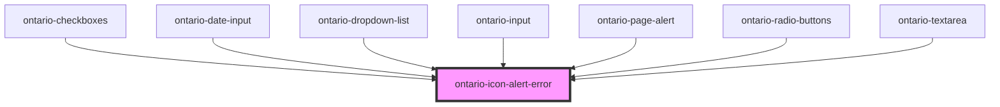

# ontario-icon-alert-error

<!-- Auto Generated Below -->

## Properties

| Property       | Attribute       | Description                                                                                                                                                  | Type                   | Default     |
| -------------- | --------------- | ------------------------------------------------------------------------------------------------------------------------------------------------------------ | ---------------------- | ----------- |
| `iconWidth`    | `icon-width`    | The icon width will autogenerate the height since the icons are in square format, thus preserving the aspect ratio.                                          | `16 \| 24 \| 32 \| 48` | `24`        |
| `isDecorative` | `is-decorative` | **[DEPRECATED]** Use the label prop to provide an accessible name. Icons without a label are decorative by default.   | `boolean \| undefined` | `undefined` |
| `label`        | `label`         | Accessible name for a meaningful icon. Without a label, the icon is decorative.                                                                              | `string \| undefined`  | `undefined` |

## Dependencies

### Used by

- [ontario-checkboxes](../../ontario-checkbox)
- [ontario-date-input](../../ontario-date-input)
- [ontario-dropdown-list](../../ontario-dropdown-list)
- [ontario-input](../../ontario-input)
- [ontario-page-alert](../../ontario-page-alert)
- [ontario-radio-buttons](../../ontario-radio-buttons)
- [ontario-textarea](../../ontario-textarea)

### Graph

---

_Built with [StencilJS](https://stenciljs.com/)_
