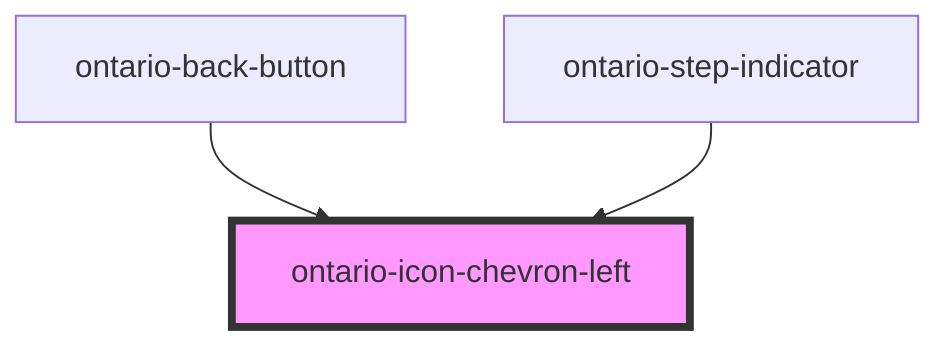

# ontario-icon-chevron-left

<!-- Auto Generated Below -->

## Properties

| Property       | Attribute       | Description                                                                                                                                                  | Type                                                  | Default     |
| -------------- | --------------- | ------------------------------------------------------------------------------------------------------------------------------------------------------------ | ----------------------------------------------------- | ----------- |
| `colour`       | `colour`        | Set the icon's colour.                                                                                                                                       | `"black" \| "blue" \| "grey" \| "inherit" \| "white"` | `'black'`   |
| `iconWidth`    | `icon-width`    | The icon width will autogenerate the height since the icons are in square format, thus preserving the aspect ratio.                                          | `16 \| 24 \| 32 \| 48`                                | `24`        |
| `isDecorative` | `is-decorative` | **[DEPRECATED]** Use the label prop to provide an accessible name. Icons without a label are decorative by default.   | `boolean \| undefined`                                | `undefined` |
| `label`        | `label`         | Accessible name for a meaningful icon. Without a label, the icon is decorative.                                                                              | `string \| undefined`                                 | `undefined` |

## Dependencies

### Used by

- [ontario-back-button](../../ontario-back-button)
- [ontario-step-indicator](../../ontario-step-indicator)

### Graph

---

_Built with [StencilJS](https://stenciljs.com/)_
