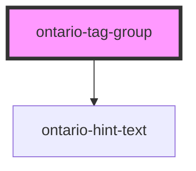

import { OntarioTag, OntarioTagGroup } from '@ongov/ontario-design-system-component-library-react';
import Tabs from '@theme/Tabs';
import TabItem from '@theme/TabItem';

# ontario-tag-group

A tag group holds a set of `ontario-tag` elements. It lays them out, gives the set an accessible name and an optional heading with a count, announces when a tag is removed, and keeps keyboard focus in a sensible place after a removal.

Use a tag group when:

- showing the filters currently applied to a set of results (the Applied filters pattern)
- showing a set of tags that filter content, such as categories or topics
- showing a set of labels a user created and can remove

Do not use a tag group when:

- there is a single tag with no related tags (use `ontario-tag` on its own)
- the items are navigation links (use a list of links, or in-page navigation)
- the items are options in a form (use checkboxes, radio buttons, or a dropdown list)

## Variations

- **Applied filters:** dismissible tags under a visible heading with a count, for example "Applied filters (6)".
- **Filter set:** non-dismissible tags under a visible heading, or with no visible heading and a `groupLabel`.

Both are the same component. The difference is which kind of `ontario-tag` is slotted in and whether there is a visible heading.

## Configuration

Once the component package has been installed (see Ontario Design System Component Library for installation instructions), the tag group component can be added directly into the project's code, and can be customized by updating the properties outlined [here](#properties). Please see the [examples](#examples) below for how to configure the component.

Place `ontario-tag` elements in the default slot. Only `ontario-tag` elements are counted and managed, including tags inside a wrapper element (such as the one `@stencil/ssr` adds in Next.js); other slotted elements are laid out but not counted.

The group gives the set an accessible name from the visible `heading`, or from `groupLabel` when there is no heading. If neither is provided, a warning is printed.

Use `hintText` to show hint text below the heading. The hint is rendered with the `ontario-hint-text` component and is used as the accessible description of the group. It accepts a string, or a `Hint` object to render HTML content.

The group does not create, remove, or reorder tags. The consuming application owns the list and the filter state. When a tag emits `tagDismissed`, remove it from the list; the group then updates the count, announces the removal, and moves focus to the next tag, then the previous tag, then the group heading. With no heading, focus moves to the group itself.

Focus and the announcement only follow a removal made within 1 second of the `tagDismissed` event, so remove the tag in the event handler rather than after a slow request. The group follows the dismissed tag element itself, so when rendering tags from a list, give each tag a stable key such as its `value`, for example `key={f.value}` in React. Keying by index reuses the dismissed element for the next tag, and the removal is not announced.

A group with no tags renders its heading with a count of 0. Remove the group from the page when there is nothing to show.

## Examples

Example of an applied filters group with a heading, count, and removal handling.

```mdx-code-block
<Tabs
	defaultValue="html"
	values={[
		{label: 'HTML', value: 'html'},
		{label: 'React', value: 'react'},
		{label: 'Angular', value: 'angular'},
	]}
	groupId="framework"
	queryString="framework">
<TabItem value="html">
```

```html
<ontario-tag-group heading="Applied filters" heading-level="h2">
	<ontario-tag label="Category: Health" value="health" dismissible></ontario-tag>
	<ontario-tag label="Region: Northern Ontario" value="north" dismissible></ontario-tag>
</ontario-tag-group>
```

```mdx-code-block
</TabItem>
<TabItem value="react">
```

```tsx
<OntarioTagGroup heading="Applied filters" headingLevel="h2">
	{filters.map((f) => (
		<OntarioTag
			key={f.value}
			label={f.label}
			value={f.value}
			dismissible
			onTagDismissed={() => removeFilter(f.value)}
		></OntarioTag>
	))}
</OntarioTagGroup>
```

```mdx-code-block
</TabItem>
<TabItem value="angular">
```

```html
<ontario-tag-group heading="Applied filters" heading-level="h2">
	<ontario-tag
		*ngFor="let f of filters"
		[label]="f.label"
		[value]="f.value"
		[dismissible]="true"
		(tagDismissed)="removeFilter(f.value)"
	></ontario-tag>
</ontario-tag-group>
```

```mdx-code-block
</TabItem>
</Tabs>
```

<div>
	<OntarioTagGroup heading="Applied filters" headingLevel="h2">
		<OntarioTag label="Category: Health" value="health" dismissible></OntarioTag>
		<OntarioTag label="Region: Northern Ontario" value="north" dismissible></OntarioTag>
	</OntarioTagGroup>
</div>

Example of a filter set of non-dismissible tags with no visible heading, using `groupLabel`.

```mdx-code-block
<Tabs
	defaultValue="html"
	values={[
		{label: 'HTML', value: 'html'},
		{label: 'React', value: 'react'},
		{label: 'Angular', value: 'angular'},
	]}
	groupId="framework"
	queryString="framework">
<TabItem value="html">
```

```html
<ontario-tag-group group-label="Topics">
	<ontario-tag label="Health"></ontario-tag>
	<ontario-tag label="Education" selected></ontario-tag>
</ontario-tag-group>
```

```mdx-code-block
</TabItem>
<TabItem value="react">
```

```tsx
<OntarioTagGroup groupLabel="Topics">
	<OntarioTag label="Health"></OntarioTag>
	<OntarioTag label="Education" selected></OntarioTag>
</OntarioTagGroup>
```

```mdx-code-block
</TabItem>
<TabItem value="angular">
```

```html
<ontario-tag-group group-label="Topics">
	<ontario-tag label="Health"></ontario-tag>
	<ontario-tag label="Education" [selected]="true"></ontario-tag>
</ontario-tag-group>
```

```mdx-code-block
</TabItem>
</Tabs>
```

<div>
	<OntarioTagGroup groupLabel="Topics">
		<OntarioTag label="Health"></OntarioTag>
		<OntarioTag label="Education" selected></OntarioTag>
	</OntarioTagGroup>
</div>

Example of a French tag group. Set `language` to `fr` so the removal announcements and the tags' "Supprimer" labels are in French.

```mdx-code-block
<Tabs
	defaultValue="html"
	values={[
		{label: 'HTML', value: 'html'},
		{label: 'React', value: 'react'},
		{label: 'Angular', value: 'angular'},
	]}
	groupId="framework"
	queryString="framework">
<TabItem value="html">
```

```html
<ontario-tag-group group-label="Sujets" language="fr">
	<ontario-tag label="Santé et bien-être" value="health" language="fr" dismissible></ontario-tag>
	<ontario-tag label="Éducation et formation" value="education" language="fr" dismissible></ontario-tag>
</ontario-tag-group>
```

```mdx-code-block
</TabItem>
<TabItem value="react">
```

```tsx
<OntarioTagGroup groupLabel="Sujets" language="fr">
	{topics.map((t) => (
		<OntarioTag
			key={t.value}
			label={t.label}
			value={t.value}
			language="fr"
			dismissible
			onTagDismissed={() => removeTopic(t.value)}
		></OntarioTag>
	))}
</OntarioTagGroup>
```

```mdx-code-block
</TabItem>
<TabItem value="angular">
```

```html
<ontario-tag-group group-label="Sujets" language="fr">
	<ontario-tag
		*ngFor="let t of topics"
		[label]="t.label"
		[value]="t.value"
		language="fr"
		[dismissible]="true"
		(tagDismissed)="removeTopic(t.value)"
	></ontario-tag>
</ontario-tag-group>
```

```mdx-code-block
</TabItem>
</Tabs>
```

<div>
	<OntarioTagGroup groupLabel="Sujets" language="fr">
		<OntarioTag label="Santé et bien-être" value="health" language="fr" dismissible></OntarioTag>
		<OntarioTag label="Éducation et formation" value="education" language="fr" dismissible></OntarioTag>
	</OntarioTagGroup>
</div>

<!-- Auto Generated Below -->

## Overview

Ontario Tag Group holds a set of `ontario-tag` elements. It lays them out, gives the set an accessible name and an optional heading with a count, announces when a tag is removed, and keeps keyboard focus in a sensible place after a removal.

The group never removes a tag itself: the consumer removes the tag in response to its `tagDismissed` event, and the group reacts to the change in its slot.

## Properties

| Property       | Attribute       | Description                                                                                                                                                                                                   | Type                          | Default     |
| -------------- | --------------- | ------------------------------------------------------------------------------------------------------------------------------------------------------------------------------------------------------------- | ----------------------------- | ----------- |
| `elementId`    | `element-id`    | The unique identifier of the group. If no `elementId` is passed, one will be generated. This property is optional.                                                                                            | `string \| undefined`         | `undefined` |
| `groupLabel`   | `group-label`   | The accessible name of the group, used when there is no visible heading. If neither `heading` nor `groupLabel` is provided, a warning is printed. This property is optional.                                  | `string \| undefined`         | `undefined` |
| `heading`      | `heading`       | The visible heading of the group, for example "Applied filters". This property is optional.                                                                                                                   | `string \| undefined`         | `undefined` |
| `headingLevel` | `heading-level` | The heading element, set by the consumer to keep the page outline correct. Accepts 'h2', 'h3' or 'h4'. Default is 'h3'.                                                                                       | `"h2" \| "h3" \| "h4"`        | `'h3'`      |
| `hintText`     | `hint-text`     | Hint text shown below the heading to explain the group, for example "Select a tag to remove it". This is passed in as a string, or as a `Hint` object to render HTML content. This property is optional.      | `Hint \| string \| undefined` | `undefined` |
| `language`     | `language`      | The language of the component. This is used for translations, and is by default set through event listeners checking for a language property from the header. If none are passed, it will default to English. | `"en" \| "fr" \| undefined`   | `undefined` |
| `showCount`    | `show-count`    | Appends the number of tags to the heading, for example "(6)". This only applies when a `heading` is set. This property is optional.                                                                           | `boolean \| undefined`        | `true`      |

## Dependencies

### Depends on

- [ontario-hint-text](../ontario-hint-text)

### Graph



---

_Built with [StencilJS](https://stenciljs.com/)_
