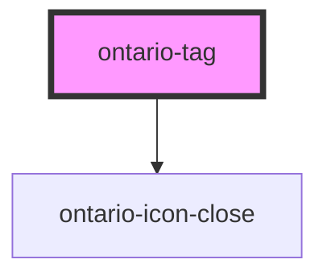

import Tabs from '@theme/Tabs';
import TabItem from '@theme/TabItem';

# ontario-tag

Tags are compact, pill-shaped controls that let users filter content, see which filters are applied, and manage labels they created.

Use tags when:

- a user filters content by category, topic, audience, or attribute
- a user needs to see and remove the filters currently applied to a set of results
- a user needs to remove a label they created

Do not use tags when:

- the control goes to another page (use a link)
- the control performs an action such as saving or submitting (use a button)
- the user chooses one option from a short list in a form (use radio buttons or a dropdown list)
- the text is only a status with no interaction (use a badge)

## Variations

- **Non-dismissible:** selects and filters content. The tag toggles between unselected and selected, and stays on the page.
- **Dismissible:** removes an applied filter or a user-created label. The tag is always shown in the selected style, with a close icon after the label, and the whole tag is one button that dismisses it. A tag never removes itself: the consuming application removes it from its list in response to the `tagDismissed` event.

## Configuration

Once the component package has been installed (see Ontario Design System Component Library for installation instructions), the tag component can be added directly into the project's code, and can be customized by updating the properties outlined [here](#properties). Please see the [examples](#examples) below for how to configure the component.

The label is plain text only. It can be passed through the `label` property or as the text content of the component, and the `label` property takes priority. If neither is provided, a warning is printed and the tag is not rendered.

The `value` property is a stable identifier sent in the `tagToggled` and `tagDismissed` events, so consumers are not tied to translated label text. If no `value` is passed, the label text is used.

The `ontario-tag` component has a public `setFocus()` method that focuses the tag's button. A tag does not manage focus itself, so for a standalone dismissible tag the consuming application should move focus after a removal.

## Examples

Example of non-dismissible tags used as category filters, unselected and selected.

```mdx-code-block
<Tabs
	defaultValue="html"
	values={[
		{label: 'HTML', value: 'html'},
		{label: 'React', value: 'react'},
		{label: 'Angular', value: 'angular'},
	]}
	groupId="framework"
	queryString="framework">
<TabItem value="html">
```

```html
<ontario-tag label="Health"></ontario-tag> <ontario-tag label="Education" selected></ontario-tag>
```

```mdx-code-block
</TabItem>
<TabItem value="react">
```

```tsx
<OntarioTag label="Health" />
<OntarioTag label="Education" selected />
```

```mdx-code-block
</TabItem>
<TabItem value="angular">
```

```html
<ontario-tag label="Health"></ontario-tag> <ontario-tag label="Education" [selected]="true"></ontario-tag>
```

```mdx-code-block
</TabItem>
</Tabs>
```

Example of a dismissible tag with removal handling.

```mdx-code-block
<Tabs
	defaultValue="html"
	values={[
		{label: 'HTML', value: 'html'},
		{label: 'React', value: 'react'},
		{label: 'Angular', value: 'angular'},
	]}
	groupId="framework"
	queryString="framework">
<TabItem value="html">
```

```html
<ontario-tag label="Category: Filter" value="category-filter" dismissible></ontario-tag>
```

```mdx-code-block
</TabItem>
<TabItem value="react">
```

```tsx
<OntarioTag
	label="Category: Filter"
	value="category-filter"
	dismissible
	onTagDismissed={(e) => removeFilter(e.detail.value)}
/>
```

```mdx-code-block
</TabItem>
<TabItem value="angular">
```

```html
<ontario-tag
	label="Category: Filter"
	value="category-filter"
	[dismissible]="true"
	(tagDismissed)="removeFilter($event.detail.value)"
></ontario-tag>
```

```mdx-code-block
</TabItem>
</Tabs>
```

<!-- Auto Generated Below -->

## Overview

Ontario Tag is a compact control used to filter content, show applied filters, and manage user-created labels.

A non-dismissible tag toggles between selected and unselected. A dismissible tag is always shown as selected and emits an event when activated, leaving removal up to the consuming application.

## Properties

| Property          | Attribute           | Description                                                                                                                                                                                                          | Type                                                  | Default     |
| ----------------- | ------------------- | -------------------------------------------------------------------------------------------------------------------------------------------------------------------------------------------------------------------- | ----------------------------------------------------- | ----------- |
| `ariaLabelText`   | `aria-label-text`   | Provides more context for the non-dismissible tag button, only if the label alone is not enough. This property is optional.                                                                                          | `string \| undefined`                                 | `undefined` |
| `customOnDismiss` | `custom-on-dismiss` | A function called when a dismissible tag is activated, in addition to the `tagDismissed` event. This property is optional.                                                                                           | `((detail: TagDismissedDetail) => void) \| undefined` | `undefined` |
| `customOnToggle`  | `custom-on-toggle`  | A function called when a non-dismissible tag is selected or deselected, in addition to the `tagToggled` event. This property is optional.                                                                            | `((detail: TagToggledDetail) => void) \| undefined`   | `undefined` |
| `dismissLabel`    | `dismiss-label`     | Overrides the accessible name of a dismissible tag. If no `dismissLabel` is passed, the translated "Remove {label}" is used. This property is optional.                                                              | `string \| undefined`                                 | `undefined` |
| `dismissible`     | `dismissible`       | Renders a close icon after the label, and makes activating the tag dismiss it. A dismissible tag always uses the selected style. This property is optional.                                                          | `boolean \| undefined`                                | `false`     |
| `elementId`       | `element-id`        | The unique identifier of the tag. If no `elementId` is passed, one will be generated. This property is optional.                                                                                                     | `string \| undefined`                                 | `undefined` |
| `label`           | `label`             | The text displayed in the tag. This overrides the text provided through the host element's text content. If neither `label` nor the host text content is provided, a warning is printed and the tag is not rendered. | `string \| undefined`                                 | `undefined` |
| `language`        | `language`          | The language of the component. This is used for translations, and is by default set through event listeners checking for a language property from the header. If none are passed, it will default to English.        | `"en" \| "fr" \| undefined`                           | `undefined` |
| `selected`        | `selected`          | The selected state of a non-dismissible tag. This is ignored, with a warning, when `dismissible` is also set. This property is optional.                                                                             | `boolean \| undefined`                                | `false`     |
| `value`           | `value`             | A stable identifier sent in events, so consumers are not tied to translated label text. If no `value` is passed, the label text is used. This property is optional.                                                  | `string \| undefined`                                 | `undefined` |

## Events

| Event          | Description                                                                                                                                                            | Type                              |
| -------------- | ---------------------------------------------------------------------------------------------------------------------------------------------------------------------- | --------------------------------- |
| `tagDismissed` | Emitted when a dismissible tag is activated by mouse, touch, or keyboard. A tag never removes itself: the consumer removes it from the list in response to this event. | `CustomEvent<TagDismissedDetail>` |
| `tagToggled`   | Emitted when a non-dismissible tag is selected or deselected by mouse, touch, or keyboard.                                                                             | `CustomEvent<TagToggledDetail>`   |

## Methods

### `setFocus() => Promise<void>`

Focuses the tag's button.

This is used by `ontario-tag-group` to move focus after a removal.

#### Returns

Type: `Promise<void>`

## Dependencies

### Depends on

- [ontario-icon-close](../ontario-icon)

### Graph



---

_Built with [StencilJS](https://stenciljs.com/)_
